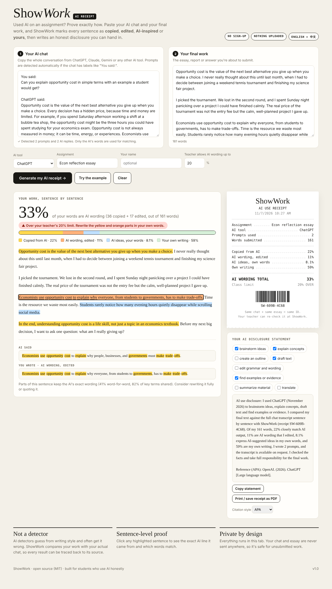

# ShowWork 🧾

**The AI receipt for your homework.** Paste your AI chat and your final work. ShowWork marks every sentence as *copied*, *edited*, *AI-inspired* or *your own*, then writes an honest, evidence-backed AI disclosure you can hand in.

**▶ Live demo:** `https://YOUR-USERNAME.github.io/showwork/?demo`



## Why this exists

Schools now let students use AI, *if they disclose it*. But the disclosure is usually a vague sentence like "I used ChatGPT for help," and teachers have no way to know what that actually means.

The alternative is AI detectors. They **guess** from writing style, produce false accusations, and can't tell "used AI to brainstorm" from "pasted the whole essay."

ShowWork flips it around. Instead of a teacher guessing, the **student proves** exactly how AI was used, by comparing the final work with the actual chat transcript.

| | AI detectors | "I used ChatGPT" statements | **ShowWork** |
|---|---|---|---|
| Based on evidence | ✗ guesses from style | ✗ self-reported | ✓ compares with the real chat |
| Sentence-level detail | partial | ✗ | ✓ every sentence traced to its source |
| Who it serves | catches students | – | **protects honest students** |
| Privacy | essays uploaded to a server | – | ✓ runs 100% in the browser |

## Features

- **4-way classification** of every sentence:
  🟨 Copied from AI · 🟧 AI wording, edited · 🟦 AI ideas, your own words · 🟩 Your own writing
- **Source tracing**: click any sentence to see the exact AI line it came from, with shared words highlighted
- **AI-wording score** checked against your teacher's limit (e.g. "max 20% AI wording")
- **Auto-written disclosure statement**: it infers *how* you used AI from your prompts (brainstorm, explain, outline, draft, edit, and so on) and includes the real percentages
- **APA / MLA / Chicago** citation for the AI tool
- **Printable receipt** with a reproducible receipt ID: the same chat plus the same essay always gives the same ID, so a teacher can re-verify it
- Detects prompts automatically in ChatGPT / Claude / Gemini copy formats ("You said:", "ChatGPT said:", "User:", "Assistant:")
- **English and Chinese (中文)** support (word n-grams for English, character n-grams for Chinese)

## How it works

1. **Parse the transcript.** Speaker labels are detected, so only the AI's words are used for matching. Your own prompts don't count against you.
2. **Verbatim check.** Every 5-word sequence (6 characters for Chinese) in your work is looked up in an index of the AI's text. Matching runs are underlined.
3. **Idea check.** Key terms (stemmed, stop-words removed) in each sentence are compared with every AI sentence and pair of adjacent sentences, which catches paraphrases.
4. **Classify.** ≥50% verbatim → *copied*; ≥15% verbatim or ≥60% shared key terms → *edited*; ≥40% shared key terms → *AI ideas*; otherwise → *yours*.

It's all plain JavaScript in one HTML file, with no AI model, no server and no dependencies.

## Run it

```bash
git clone https://github.com/YOUR-USERNAME/showwork.git
open showwork/index.html
```

Or deploy your own copy: **Settings → Pages → Deploy from branch → main / root**.

## Roadmap

- [ ] Browser extension: one-click "export chat to ShowWork" from ChatGPT / Claude
- [ ] Upload .docx / Google Docs export directly
- [ ] Teacher mode: paste a student's receipt ID plus their files to verify
- [ ] Multiple chats per assignment

## License

MIT
